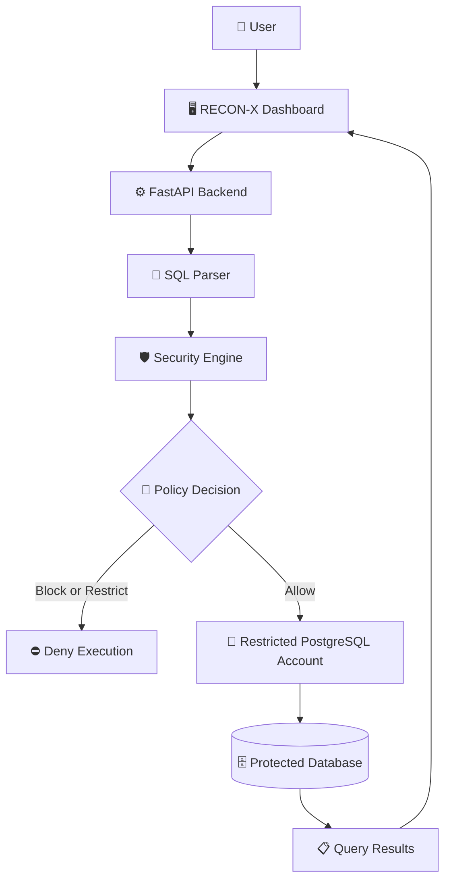

# 🛡️ RECON-X — Database Security Gateway

### 🔍 Detect. Assess. Protect.

**RECON-X** is a database security gateway designed to inspect SQL queries, assess security risks, enforce access policies, and prevent unauthorized data access before queries reach a protected database.

It provides a centralized security dashboard for query analysis, risk assessment, policy enforcement, audit logs, and protected database execution.

<p align="center">
  
  
  
  
</p>

---

## 📌 Table of Contents

- [✨ Key Features](#-key-features)
- [🏗️ Architecture](#️-architecture)
- [🧰 Technology Stack](#-technology-stack)
- [📂 Project Structure](#-project-structure)
- [⚙️ Installation](#️-installation-and-setup)
- [🗄️ Database Configuration](#️-database-configuration)
- [🔄 How It Works](#-how-it-works)
- [🧪 Example Queries](#-example-queries)
- [🔌 API Endpoints](#-api-endpoints)
- [🔐 Security Model](#-security-model)
- [🧪 Testing](#-testing)
- [☁️ Deployment](#️-deployment)
- [🚀 Future Enhancements](#-future-enhancements)
- [👥 Team](#-team)

---

## ✨ Key Features

| Feature | Description |
|---|---|
| 🔎 SQL Inspection | Analyze SQL statements before execution using SQL parsing and security rules. |
| 📊 Risk Assessment | Evaluate query risk and provide security decisions. |
| 🚦 Policy Enforcement | Allow, flag, restrict, or block queries according to applicable policies. |
| 🛡️ Protected Execution | Execute supported PostgreSQL queries through a restricted database account. |
| 🗄️ Database Integration | Integrate with PostgreSQL and existing demo datasets. |
| 📈 Security Dashboard | Display query activity, risk indicators, execution results, and system status. |
| 🧾 Audit Logging | Record security decisions and relevant query activity. |
| 🕵️ Inference Detection | Detect suspicious query patterns that may reveal protected information. |
| 🔑 Role-Based Access Control | Apply access restrictions according to configured user roles and permissions. |
| 🔒 Privacy Controls | Include privacy-oriented mechanisms such as differential privacy in supported workflows. |

## 🏗️ Architecture

RECON-X places a security inspection and enforcement layer between the user and the protected database.



> 🔐 **Security principle:** Protected database queries must pass through the backend security gateway. Database credentials must never be exposed to the browser.

## 🧰 Technology Stack

| Layer | Technology |
|---|---|
| 🎨 Frontend | HTML, CSS, JavaScript |
| ⚙️ Backend | Python, FastAPI |
| 🔍 SQL Parsing | SQLGlot |
| 💾 Application Storage | SQLite |
| 🐘 Protected Database | PostgreSQL |
| 🔌 Database Driver | Psycopg 3 |
| 📚 API Documentation | FastAPI / OpenAPI |
| ☁️ Application Hosting | Render |
| 🌐 Hosted Database | PostgreSQL / Supabase |

## 📂 Project Structure

```text
RECON-X/
├── app/
│   ├── api/
│   │   ├── routes_analytics.py
│   │   ├── routes_audit.py
│   │   ├── routes_auth.py
│   │   ├── routes_connections.py
│   │   ├── routes_datasets.py
│   │   ├── routes_events.py
│   │   ├── routes_history.py
│   │   ├── routes_pg.py
│   │   ├── routes_policies.py
│   │   └── routes_proxy.py
│   ├── core/
│   │   ├── audit.py
│   │   ├── diff_privacy.py
│   │   ├── engine.py
│   │   ├── parser.py
│   │   ├── proxy.py
│   │   └── rbac.py
│   ├── db/
│   │   ├── connection.py
│   │   ├── pg_service.py
│   │   ├── seed_data.py
│   │   └── sqlite_utils.py
│   └── static/
│       ├── index.html
│       ├── css/
│       │   └── style.css
│       └── js/
│           ├── app.js
│           ├── components.js
│           ├── icons.js
│           └── supabase-config.js
├── extension/
├── shop/
├── supabase/
├── tests/
├── .env.example
├── .gitignore
├── render.yaml
├── README.md
├── requirements.txt
└── run.py
```

## ⚙️ Installation and Setup

### 📋 Prerequisites

Before getting started, ensure you have:

- 🐍 Python compatible with the project dependencies
- 🐘 PostgreSQL 18 or a compatible PostgreSQL server
- 🔧 Git
- 💻 Visual Studio Code or another code editor

### 1️⃣ Clone the repository

```bash
git clone <YOUR_REPOSITORY_URL>
cd Team_Elite_Recon-X_Hackyard_2026-main
```

Replace `<YOUR_REPOSITORY_URL>` with your actual GitHub repository URL.

### 2️⃣ Create a virtual environment

On Windows PowerShell:

```powershell
python -m venv .venv
.\.venv\Scripts\Activate.ps1
```

If you already have a virtual environment in the parent directory, activate that environment instead.

### 3️⃣ Install dependencies

```powershell
python -m pip install -r requirements.txt
```

### 4️⃣ Configure environment variables

Create a local `.env` file using `.env.example` as a reference.

Copy the placeholder template:

```powershell
Copy-Item .env.example .env
```

Set PostgreSQL variables only if using the protected PostgreSQL endpoints. The
application role must be `reconx_demo_reader`; never use a database
administrator account. `DATABASE_URL` can be used instead of the individual
`PG*` variables. Supabase connections use TLS.

> ⚠️ Never commit `.env` or database passwords to GitHub. Keep `.env` excluded through `.gitignore`.

### 5️⃣ Initialize and start RECON-X

```powershell
$env:RECONX_DATA_DIR = ".\app\db"
$env:RECONX_SEED_DEMO_DATA = "true"
python run.py
```

Demo seeding is opt-in and happens only when the target database tables are
empty. Set `RECONX_SEED_DEMO_DATA` to `false` after the initial local demo
setup; application startup creates missing tables without dropping data.

To run without demo records:

```powershell
$env:RECONX_SEED_DEMO_DATA = "false"
python run.py
```

🌐 Open the dashboard:

**http://localhost:8000**

📚 Interactive API documentation:

**http://localhost:8000/docs**

## 🗄️ Database Configuration

The existing local PostgreSQL demo database is named `reconx_demo`.

| Table | Existing local demo records |
|---|---:|
| `customers` | 8 |
| `employees` | 5 |
| `transactions` | 10 |
| `audit_demo` | 5 |
| **Total** | **28** |

These counts describe the previously verified local dataset; the hosted Supabase database must be checked independently after migration.

### 🔐 Restricted Database Access

The current PostgreSQL reader account has limited permissions on the primary-key columns of the four demo tables.

The supported PostgreSQL execution workflow allows approved whole-table count queries. It does not provide unrestricted access to customer details or arbitrary SQL execution.

## 🔄 How It Works

1. 📝 **Submit:** The user submits a SQL query through the RECON-X dashboard.
2. 🔎 **Inspect:** The backend parses and analyzes the SQL statement.
3. 📊 **Assess:** The security engine evaluates applicable risk signals and policies.
4. 🚦 **Decide:** The gateway determines whether the query may proceed.
5. 🛡️ **Enforce:** Blocked queries are denied; approved queries proceed through the restricted database account.
6. 🗄️ **Execute:** The database executes the approved query.
7. 📋 **Display:** The dashboard shows actual returned results and execution details.
8. 🧾 **Audit:** Relevant security events and decisions can be recorded for investigation.

## 🧪 Example Queries

### ✅ Approved query

```sql
SELECT COUNT(customer_id) FROM customers;
```

For the existing local demo dataset, the expected result is:

| count |
|---:|
| 8 |

The result should be confirmed against the active database connection before presenting it as a live result.

### ⛔ Blocked query

```sql
SELECT customer_id, email FROM customers;
```

This query is outside the current PostgreSQL execution allowlist and should be denied by the security gateway.

The dashboard should indicate that the query was not executed rather than displaying stale or fabricated results.

## 🔌 API Endpoints

| Method | Endpoint | Purpose |
|---|---|---|
| `POST` | `/api/pg/test` | 🩺 Check PostgreSQL connectivity |
| `POST` | `/api/pg/inspect` | 🔎 Analyze SQL without executing it |
| `POST` | `/api/pg/query` | 🛡️ Analyze and conditionally execute an approved query |
| `GET` | `/api/pg/schema` | 🗂️ Retrieve permitted schema metadata |

These endpoints are documented by the current application. Their availability in production must be verified after deployment.

## 🔐 Security Model

RECON-X is designed around controlled database access.

- 🔑 Use restricted database accounts instead of administrator credentials.
- 🔒 Keep secrets in private backend environment variables.
- 🛡️ Enforce query allowlists and authorization policies.
- ⛔ Prevent blocked queries from reaching the execution stage.
- 🧹 Avoid exposing sensitive data or raw database errors in API responses.
- 🔀 Keep analysis-only endpoints separate from query execution.
- 🚫 Never connect the browser directly to PostgreSQL.
- 🔍 Verify permissions after database migration.
- 📉 Do not let a low risk score override mandatory access restrictions.

## 🧪 Testing

Run the automated test suite from the project root:

```powershell
python -m pytest -q
```

To disable opt-in live PostgreSQL integration tests:

```powershell
$env:RECONX_RUN_PG_INTEGRATION = "0"
python -m pytest -q
```

A successful unit-test run does not prove that the production database connection or deployment is working. Verify those separately.

## ☁️ Render Deployment

The root `render.yaml` defines the FastAPI web service, health check, and a
persistent disk mounted at `/var/data`. The disk requires a paid Render web
service and supports one service instance; SQLite files are not shared across
multiple instances. Do not remove the disk or change its mount path after
production data is stored.

### Build and start commands

```text
pip install -r requirements.txt
uvicorn app.main:app --host 0.0.0.0 --port $PORT
```

The FastAPI application is `app.main:app`. The root URL serves the dashboard,
`/intro` retains the intro page, `/shop` serves the Supabase storefront, and
`/health` is the Render health check. FastAPI serves `/static/*` assets.

### Deploy steps

1. Push the reviewed branch to GitHub; do not commit `.env` or SQLite `.db`,
   `-wal`, or `-shm` files.
2. In Render, choose **New → Blueprint** and select this repository and branch.
3. Before creating the service, enter unique values for the required
   `RECONX_AUTH_USERNAME` and `RECONX_AUTH_PASSWORD` variables when prompted.
   The password must be at least 16 characters. These protect the dashboard,
   APIs, and static files with HTTP Basic authentication over Render HTTPS;
   `/health` remains public for the platform health check.
4. Confirm Render creates the `/var/data` persistent disk. Keep one service
   instance because the SQLite files and WAL are on that disk.
5. Add optional PostgreSQL variables only if enabling protected PostgreSQL
   features. Set `PGSSLMODE=require`, use the dedicated `reconx_demo_reader`
   role, and provide either `DATABASE_URL` or `PGHOST`, `PGPORT`, `PGDATABASE`,
   `PGUSER`, and `PGPASSWORD`. Do not use a superuser or Supabase service-role
   key.
6. For the Supabase storefront, set `SUPABASE_URL` and
   `SUPABASE_PUBLISHABLE_KEY` to the project URL and public publishable/anon
   key. Never set a service-role key. Ensure Supabase Row Level Security and
   policies are enabled.
7. Leave `RECONX_SEED_DEMO_DATA=false` unless explicitly creating a new demo
   volume. Existing nonempty SQLite tables are never seeded over.
8. Deploy manually, then verify the dashboard, `/health`, static assets, and
   `/api/pg/status`. Use `/api/pg/test` only when intentionally testing the
   configured PostgreSQL connection.

### Render environment variables

| Variable | Requirement | Purpose |
|---|---|---|
| `RECONX_DATA_DIR=/var/data` | Required by Blueprint | SQLite persistent disk location |
| `RECONX_AUTH_USERNAME` | Required | HTTP Basic deployment username |
| `RECONX_AUTH_PASSWORD` | Required, 16+ characters | HTTP Basic deployment password |
| `RECONX_SEED_DEMO_DATA=false` | Recommended | Prevent automatic sample-data seeding |
| `PGSSLMODE=require` | Required when PG is configured | TLS for Supabase/remote PostgreSQL |
| `DATABASE_URL` or `PGHOST`, `PGPORT`, `PGDATABASE`, `PGUSER`, `PGPASSWORD` | Optional | Protected PostgreSQL connection; use the restricted reader |
| `SUPABASE_URL`, `SUPABASE_PUBLISHABLE_KEY` | Optional | Browser-safe Supabase storefront configuration |
| `RECONX_CORS_ORIGINS` | Optional | Comma-separated allowed HTTP(S) origins; Render's own URL is added automatically |
| `PORT` | Render-managed | Assigned listening port; do not set manually |

Render's disk-backed SQLite deployment is suitable for a single-instance demo
or modest deployment, not horizontal scaling or high write volume. If future
requirements need multiple instances, coordinated writes, or managed backups,
evaluate an application-storage database migration separately. The protected
PostgreSQL database serves a different purpose and is not a drop-in replacement
for the four internal SQLite demo datasets.

### Authentication and production limitations

The existing in-app user/role switcher is a demonstration RBAC feature, not a
production identity provider. The deployment-level Basic-auth gate protects
the public service but is a shared credential, not per-user authorization.
Before inviting multiple users or processing real sensitive data, integrate a
real identity provider and enforce user/role permissions on every API route.
Audit logs, query/session history, security events, differential-privacy
budgets, and policy changes are currently held in process memory and reset on
restart; the Render disk only persists the four sector SQLite datasets.
Implement durable storage for those records before relying on them for audit
retention or compliance.
The checked-in shop seed data also contains demo account hashes; do not load it
into production. This repository change does not deploy the separate optional
Node.js shop API.

### Previously committed credential-like values

The reachable Git history contains hardcoded demo database/authentication
values from earlier commits and the former storefront contained a Supabase
publishable key. The demo values have been removed from the current source
where practical; Git history was not rewritten. Rotate any value that was
real, reused, or granted access. The publishable/anon key is intended for
browser use, but its Supabase project must enforce Row Level Security. No
private Supabase service-role key was found in the scanned reachable history.

## 🚀 Future Enhancements

- 🧠 Adaptive intelligence using historical query patterns
- 📈 Explainable anomaly detection
- 🧑‍⚖️ Authorized reviewer feedback for security decisions
- 🧾 Enhanced audit reports
- 🔐 Authorized access to approved database records
- 🧪 Expanded live integration and deployment tests
- 📡 Improved monitoring for suspicious query sequences

Any learning mechanism must preserve mandatory authorization, database permissions, and query execution restrictions.

## 👥 Team

**Project:** RECON-X — Database Security Gateway  
**Tagline:** Detect. Assess. Protect.  
**Event:** Hackyard 2026  
**Team:** Team Elite

## 📄 License

Add the license applicable to your repository before distributing the project.

---

<p align="center">
  <strong>🛡️ RECON-X — Detect. Assess. Protect.</strong><br/>
  <sub>Making database access more secure, controlled, and transparent.</sub>
</p>
