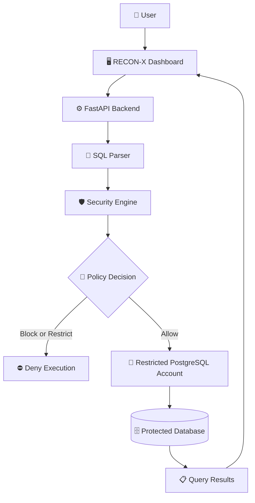

# 🛡️ RECON-X — Database Security Gateway

### 🔍 Detect. Assess. Protect.

**RECON-X** is a database security gateway designed to inspect SQL queries, assess security risks, enforce access policies, and prevent unauthorized data access before queries reach a protected database.

It provides a centralized security dashboard for query analysis, risk assessment, policy enforcement, audit logs, and protected database execution.

<p align="center">
  
  
  
  
</p>

---

## 📌 Table of Contents

- [✨ Key Features](#-key-features)
- [🏗️ Architecture](#️-architecture)
- [🧰 Technology Stack](#-technology-stack)
- [📂 Project Structure](#-project-structure)
- [⚙️ Installation](#️-installation-and-setup)
- [🗄️ Database Configuration](#️-database-configuration)
- [🔄 How It Works](#-how-it-works)
- [🧪 Example Queries](#-example-queries)
- [🔌 API Endpoints](#-api-endpoints)
- [🔐 Security Model](#-security-model)
- [🧪 Testing](#-testing)
- [☁️ Deployment](#️-deployment)
- [🚀 Future Enhancements](#-future-enhancements)
- [👥 Team](#-team)

---

## ✨ Key Features

| Feature | Description |
|---|---|
| 🔎 SQL Inspection | Analyze SQL statements before execution using SQL parsing and security rules. |
| 📊 Risk Assessment | Evaluate query risk and provide security decisions. |
| 🚦 Policy Enforcement | Allow, flag, restrict, or block queries according to applicable policies. |
| 🛡️ Protected Execution | Execute supported PostgreSQL queries through a restricted database account. |
| 🗄️ Database Integration | Integrate with PostgreSQL and existing demo datasets. |
| 📈 Security Dashboard | Display query activity, risk indicators, execution results, and system status. |
| 🧾 Audit Logging | Record security decisions and relevant query activity. |
| 🕵️ Inference Detection | Detect suspicious query patterns that may reveal protected information. |
| 🔑 Role-Based Access Control | Apply access restrictions according to configured user roles and permissions. |
| 🔒 Privacy Controls | Include privacy-oriented mechanisms such as differential privacy in supported workflows. |

## 🏗️ Architecture

RECON-X places a security inspection and enforcement layer between the user and the protected database.



> 🔐 **Security principle:** Protected database queries must pass through the backend security gateway. Database credentials must never be exposed to the browser.

## 🧰 Technology Stack

| Layer | Technology |
|---|---|
| 🎨 Frontend | HTML, CSS, JavaScript |
| ⚙️ Backend | Python, FastAPI |
| 🔍 SQL Parsing | SQLGlot |
| 💾 Application Storage | SQLite |
| 🐘 Protected Database | PostgreSQL |
| 🔌 Database Driver | Psycopg 3 |
| 📚 API Documentation | FastAPI / OpenAPI |
| ☁️ Application Hosting | Vercel — planned |
| 🌐 Hosted Database | Supabase PostgreSQL — migration in progress |

## 📂 Project Structure

```text
RECON-X/
├── app/
│   ├── api/
│   │   ├── routes_analytics.py
│   │   ├── routes_audit.py
│   │   ├── routes_auth.py
│   │   ├── routes_connections.py
│   │   ├── routes_datasets.py
│   │   ├── routes_events.py
│   │   ├── routes_history.py
│   │   ├── routes_pg.py
│   │   ├── routes_policies.py
│   │   └── routes_proxy.py
│   ├── core/
│   │   ├── audit.py
│   │   ├── diff_privacy.py
│   │   ├── engine.py
│   │   ├── parser.py
│   │   ├── proxy.py
│   │   └── rbac.py
│   ├── db/
│   │   ├── connection.py
│   │   ├── pg_service.py
│   │   └── seed_data.py
│   └── static/
│       ├── index.html
│       ├── css/
│       │   └── style.css
│       └── js/
│           ├── app.js
│           ├── components.js
│           ├── icons.js
│           └── supabase-config.js
├── extension/
├── shop/
├── supabase/
├── tests/
├── .env.example
├── .gitignore
├── README.md
├── requirements.txt
└── run.py
```

## ⚙️ Installation and Setup

### 📋 Prerequisites

Before getting started, ensure you have:

- 🐍 Python compatible with the project dependencies
- 🐘 PostgreSQL 18 or a compatible PostgreSQL server
- 🔧 Git
- 💻 Visual Studio Code or another code editor

### 1️⃣ Clone the repository

```bash
git clone <YOUR_REPOSITORY_URL>
cd Team_Elite_Recon-X_Hackyard_2026-main
```

Replace `<YOUR_REPOSITORY_URL>` with your actual GitHub repository URL.

### 2️⃣ Create a virtual environment

On Windows PowerShell:

```powershell
python -m venv .venv
.\.venv\Scripts\Activate.ps1
```

If you already have a virtual environment in the parent directory, activate that environment instead.

### 3️⃣ Install dependencies

```powershell
python -m pip install -r requirements.txt
```

### 4️⃣ Configure environment variables

Create a local `.env` file using `.env.example` as a reference.

Example for the local PostgreSQL setup:

```dotenv
PGHOST=127.0.0.1
PGPORT=5432
PGDATABASE=reconx_demo
PGUSER=reconx_demo_reader
PGPASSWORD=your_local_database_password
```

Replace the example password with your actual local credential.

> ⚠️ Never commit `.env` or database passwords to GitHub. Keep `.env` excluded through `.gitignore`.

### 5️⃣ Start RECON-X

```powershell
python run.py
```

If using the existing parent-level virtual environment:

```powershell
$env:PATH = "C:\Program Files\PostgreSQL\18\bin;$env:PATH"
& "..\.venv\Scripts\python.exe" run.py
```

🌐 Open the dashboard:

**http://localhost:8000**

📚 Interactive API documentation:

**http://localhost:8000/docs**

## 🗄️ Database Configuration

The existing local PostgreSQL demo database is named `reconx_demo`.

| Table | Existing local demo records |
|---|---:|
| `customers` | 8 |
| `employees` | 5 |
| `transactions` | 10 |
| `audit_demo` | 5 |
| **Total** | **28** |

These counts describe the previously verified local dataset; the hosted Supabase database must be checked independently after migration.

### 🔐 Restricted Database Access

The current PostgreSQL reader account has limited permissions on the primary-key columns of the four demo tables.

The supported PostgreSQL execution workflow allows approved whole-table count queries. It does not provide unrestricted access to customer details or arbitrary SQL execution.

## 🔄 How It Works

1. 📝 **Submit:** The user submits a SQL query through the RECON-X dashboard.
2. 🔎 **Inspect:** The backend parses and analyzes the SQL statement.
3. 📊 **Assess:** The security engine evaluates applicable risk signals and policies.
4. 🚦 **Decide:** The gateway determines whether the query may proceed.
5. 🛡️ **Enforce:** Blocked queries are denied; approved queries proceed through the restricted database account.
6. 🗄️ **Execute:** The database executes the approved query.
7. 📋 **Display:** The dashboard shows actual returned results and execution details.
8. 🧾 **Audit:** Relevant security events and decisions can be recorded for investigation.

## 🧪 Example Queries

### ✅ Approved query

```sql
SELECT COUNT(customer_id) FROM customers;
```

For the existing local demo dataset, the expected result is:

| count |
|---:|
| 8 |

The result should be confirmed against the active database connection before presenting it as a live result.

### ⛔ Blocked query

```sql
SELECT customer_id, email FROM customers;
```

This query is outside the current PostgreSQL execution allowlist and should be denied by the security gateway.

The dashboard should indicate that the query was not executed rather than displaying stale or fabricated results.

## 🔌 API Endpoints

| Method | Endpoint | Purpose |
|---|---|---|
| `POST` | `/api/pg/test` | 🩺 Check PostgreSQL connectivity |
| `POST` | `/api/pg/inspect` | 🔎 Analyze SQL without executing it |
| `POST` | `/api/pg/query` | 🛡️ Analyze and conditionally execute an approved query |
| `GET` | `/api/pg/schema` | 🗂️ Retrieve permitted schema metadata |

These endpoints are documented by the current application. Their availability in production must be verified after deployment.

## 🔐 Security Model

RECON-X is designed around controlled database access.

- 🔑 Use restricted database accounts instead of administrator credentials.
- 🔒 Keep secrets in private backend environment variables.
- 🛡️ Enforce query allowlists and authorization policies.
- ⛔ Prevent blocked queries from reaching the execution stage.
- 🧹 Avoid exposing sensitive data or raw database errors in API responses.
- 🔀 Keep analysis-only endpoints separate from query execution.
- 🚫 Never connect the browser directly to PostgreSQL.
- 🔍 Verify permissions after database migration.
- 📉 Do not let a low risk score override mandatory access restrictions.

## 🧪 Testing

Run the automated test suite from the project root:

```powershell
python -m pytest -q
```

To disable opt-in live PostgreSQL integration tests:

```powershell
$env:RECONX_RUN_PG_INTEGRATION = "0"
python -m pytest -q
```

A successful unit-test run does not prove that the production database connection or deployment is working. Verify those separately.

## ☁️ Deployment

### 🎯 Planned Deployment Architecture

| Component | Platform |
|---|---|
| 🌐 Application | Vercel |
| 🐘 Hosted PostgreSQL | Supabase |
| 🔐 Secrets | Private hosting environment variables |

### 🚀 Deployment Checklist

- [ ] Export the existing local PostgreSQL demo database.
- [ ] Import the schema and records into Supabase.
- [ ] Verify all four demo tables and their records.
- [ ] Recreate restricted database roles and grants.
- [ ] Configure secure PostgreSQL connectivity and SSL.
- [ ] Configure backend environment variables in Vercel.
- [ ] Verify FastAPI runtime and static-file compatibility.
- [ ] Test approved and blocked queries against the hosted database.
- [ ] Confirm that credentials are absent from frontend assets and Git history.

> 📌 **Deployment status:** The Supabase migration and Vercel deployment are planned and must be verified before being described as production-ready.

## 🚀 Future Enhancements

- 🧠 Adaptive intelligence using historical query patterns
- 📈 Explainable anomaly detection
- 🧑‍⚖️ Authorized reviewer feedback for security decisions
- 🧾 Enhanced audit reports
- 🔐 Authorized access to approved database records
- 🧪 Expanded live integration and deployment tests
- 📡 Improved monitoring for suspicious query sequences

Any learning mechanism must preserve mandatory authorization, database permissions, and query execution restrictions.

## 👥 Team

**Project:** RECON-X — Database Security Gateway  
**Tagline:** Detect. Assess. Protect.  
**Event:** Hackyard 2026  
**Team:** Team Elite

## 📄 License

Add the license applicable to your repository before distributing the project.

---

<p align="center">
  <strong>🛡️ RECON-X — Detect. Assess. Protect.</strong><br/>
  <sub>Making database access more secure, controlled, and transparent.</sub>
</p>
